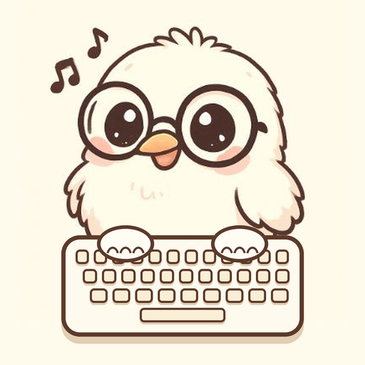

<p align="center"></p>

# Keybound Brawler Helper

[](https://ko-fi.com/kewiv)

Dalamud plugin for the **Keybound Brawler** Gold Saucer event (FFXIV × FFVII Remake).

> ⚠️ Auto-play is against the FFXIV Terms of Service. Use at your own risk.

## Install

1. In game: `/xlsettings` → **Experimental** → **Custom Plugin Repositories**
2. Add this URL, tick it, and save:

   ```
   https://raw.githubusercontent.com/KEWI-hub/KeyboundBrawler/main/repo.json
   ```

3. `/xlplugins` → search **Keybound Brawler Helper** → Install
4. `/kbb` opens the window, `/kbb auto` toggles auto-play, `/kbb debug` shows the UI scanner

Chat and commands are blocked inside the minigame, so set things up before entering.
Tick **Start auto-play when a match begins** and it starts and stops by itself.

## What auto-play does

- Reads enemy words from the `KTGEWord` addon and types them
- Speed presets: Human 60, Programmer 90, Monkey 100, KEWI 270 WPM
- Opens the input box with Enter before each word (the box closes after every submit)
- Never types while chat or another text box has focus
- Priority by label colour: green barrier phrases, then red, then gold casters, then the closest enemy
- Holds every key during Cursed Gaze / Dynamic Sensory Jammer (the crossed-out keyboard sign)
- Remembers boss words before they get obscured
- Optional: skip the punctuation the game does not require ( ? ! - ' )
- Resets the duty's inactivity timer on every key it sends, so you are not expelled for "extended inactivity"

## Tracker

Counts runs and MGC from chat, and shows how many runs you still need for the rewards you tick.

## Build

```
dotnet build -c Release
```

Needs the .NET 10 SDK and XIVLauncher with Dalamud installed. Output: `KeyboundBrawler/bin/x64/Release/KeyboundBrawler/latest.zip`.

## Support

This plugin is free. If it saved you some typing, you can buy me a coffee at
**[ko-fi.com/kewiv](https://ko-fi.com/kewiv)**. Entirely optional.
